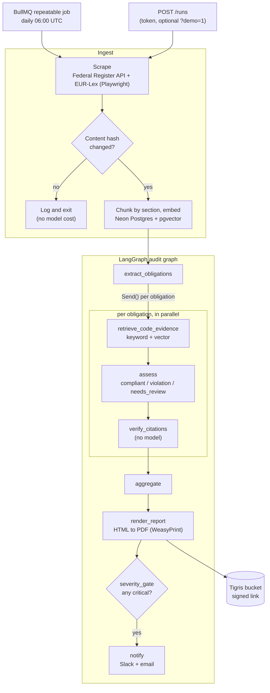

# Compliance Sentinel

An agent that watches regulatory portals, works out what new rules require of software, audits a codebase against them, and produces a cited report with alerts for critical findings.

Each day it checks two sources for new or amended rules. When something changed, it embeds the rule text, extracts the obligations a software team would have to implement, searches the target repository for evidence, and judges each obligation as compliant, a violation, or needing human review. Every finding cites the regulation section and the exact `file:line` in the code. Critical violations go to Slack and email.

> This is decision support, not legal advice. It does not guarantee compliance or complete coverage of any regulation.

## Status

| Part | State |
|---|---|
| Scrape, change detection, embedding, LangGraph audit, report, alerts | Built and tested (66 tests) |
| Dashboard (Next.js 16, Clerk) in [web/](web) | Built; 7 Playwright e2e tests against a mock API; verified locally against Neon. Clerk keys not yet configured; **not yet deployed** |
| Federal Register API source | Verified against the live API |
| EUR-Lex Playwright source | Verified against the live site (GDPR: 99 articles, plus its corrigendum) |
| Full run on live sources, then a second run that correctly skips | Verified locally |
| Neon Postgres with pgvector, including the Postgres checkpointer | Verified: migrations and a demo audit ran against Neon |
| Audit with Claude (`claude-sonnet-5-5`, `claude-haiku-5-5`) and Voyage `voyage-law-2` | Implemented, **not yet run**: needs API keys |
| Docker image and PDF rendering with WeasyPrint | Verified in CI on every push (image builds, demo report renders to a 17-page PDF) |
| BullMQ worker and cron | Implemented and typechecked; **not yet run against Redis** |
| Fly.io deployment | `Dockerfile` and `fly.toml` written; **not yet deployed** |
| Loom demo | Not recorded yet |

Without API keys the pipeline still runs end to end using two labelled stand-ins: a keyword-based offline analyst instead of Claude, and a local hash embedder instead of Voyage. That is what the tests and the sample report use.

## Sample report

[samples/report-example.pdf](samples/report-example.pdf) is the report for the demo rules audited against [demo-target-app](demo-target-app), produced by the offline analyst and rendered by WeasyPrint inside the production image. The `image` job in CI rebuilds it on every push and attaches it to the run as the `demo-report` artifact. [samples/report-example.html](samples/report-example.html) is the HTML it is rendered from.

## Architecture


[docs/architecture.html](docs/architecture.html) is the interactive version (open it locally): each component links to its source file, and three guided views walk through the trigger path, the audit's inputs and its outputs. It is generated from [docs/architecture.json](docs/architecture.json) with Archify.

The pipeline, step by step:



One Fly app runs two process groups from the same image:

- `web`: a small Hono server. `GET /health`, `POST /runs` (manual trigger), `GET /runs` (`?counts=1` adds finding counts), `GET /runs/:id`, `GET /runs/:id/findings` (`?status=` and `?severity=` take comma lists), `GET /rules`, `GET /stats`, and `GET /reports/:id` (redirects to a freshly signed link). Everything except `/health` needs `RUN_TRIGGER_TOKEN`. It can scale to zero.
- `worker`: the BullMQ worker, which also registers the daily schedule. One machine, always on.

The dashboard in [web/](web) is a separate Next.js app, deployed to Vercel. Its server components call the API with the token; the browser only talks to the dashboard, which signs users in with Clerk.

## Dashboard

[web/](web) is built on the IntelliForge stack: Next.js 16 App Router, React 19, Tailwind 4, Clerk, zod and lucide-react. It has its own `package.json` and lockfile, so the API's image and CI are unaffected.

| Page | Shows |
|---|---|
| `/` | Finding counts from the latest completed audit, its critical violations, and a **Run audit** button |
| `/runs` | The 20 most recent runs with status, duration, violations and cost |
| `/runs/[id]` | Every finding in a run, filterable by verdict and severity, each with its regulation citation and `file:line` evidence |
| `/rules` | Tracked regulations, their source, last change and last audit |

Run it locally next to the API:

```bash
pnpm dev:web                         # API on :8080 (repo root)
cd web && pnpm install
cp .env.example .env.local           # SENTINEL_API_TOKEN = the root RUN_TRIGGER_TOKEN, plus Clerk keys
pnpm dev                             # dashboard on :3000
pnpm test:e2e                        # builds the app and runs Playwright against tests/e2e/mock-api.mjs
```

**Run audit** only queues a job. It needs Redis and the worker (`docker compose up -d`, `pnpm dev:worker`); without them the button reports that the queue is unreachable.

To deploy, import the repo into Vercel with **Root Directory** set to `web`, and set `SENTINEL_API_URL` (the Fly app's URL), `SENTINEL_API_TOKEN`, `NEXT_PUBLIC_CLERK_PUBLISHABLE_KEY` and `CLERK_SECRET_KEY`.

## How it works

1. **Scrape.** The Federal Register's JSON API returns recent final rules; the binding regulatory text is separated from the preamble commentary. EUR-Lex is scraped with Playwright because it renders through JavaScript; the base act and the acts that amend or correct it are collected.
2. **Diff.** Rule text is normalised and hashed. Only rules that are new or whose hash changed go further, so a quiet day costs nothing.
3. **Embed.** Rules are split on article and section headings so each chunk maps to a citable unit, then embedded into pgvector. The target repository is indexed in line windows at a recorded snapshot.
4. **Extract obligations.** For each rule the model lists the duties software must implement, with the chunk ids that state each one and search keywords for the codebase. Chunk ids the model was not shown are discarded.
5. **Retrieve evidence.** Per obligation, keyword search over the indexed files is combined with vector similarity.
6. **Assess.** The model judges the obligation against the evidence. A verdict needs at least one regulation chunk and one code location, otherwise it must answer `needs_review`.
7. **Verify citations.** With no model involved, every cited chunk must exist and belong to the rule, and every `file:line` range must exist in the indexed snapshot. Failures are dropped; a verdict left without both kinds of support is downgraded to `needs_review`.
8. **Report and alert.** Findings are deduplicated, rendered to PDF, stored, and a critical violation triggers Slack and email.

Guardrails: a per-run cost cap (`MAX_RUN_COST_USD`), retries with backoff on every node, and graph state checkpointed to Postgres after each step. A run that fails marks its rules as unaudited so the job retry, or the next day's run, picks them up again. Resuming a crashed run from its checkpoint is not wired up yet: a retry starts a fresh run.

## Setup

Requires Node 22 and pnpm. Nothing else is needed for a dry run.

```bash
git clone https://github.com/gengirish/compliance-sentinel.git && cd compliance-sentinel
pnpm install
cp .env.example .env          # optional: add keys to use Claude, Voyage, Slack
pnpm audit:run --demo         # audit the demo app against the bundled demo rules
pnpm test
```

`pnpm audit:run` (no flag) scrapes the live sources instead; it needs `npx playwright install chromium` once, or `SCRAPE_EURLEX=false`.

Other commands:

| Command | What it does |
|---|---|
| `pnpm audit:run --rules 1,2` | Audit rules already in the store, without scraping |
| `pnpm eval:golden` | Score a demo audit against the planted violations |
| `pnpm eval:retrieval` | Print top-k rule and code chunks for ten hand-written queries |
| `pnpm db:migrate` | Apply migrations |
| `pnpm dev:web` / `pnpm dev:worker` | Run the HTTP server or the queue worker (worker needs Redis) |
| `pnpm dev:dashboard` | Run the Next.js dashboard on :3000 (see [Dashboard](#dashboard)) |
| `docker compose up -d` | Local Redis for the queue |

Set `DATABASE_URL` to a Neon connection string to use Neon locally too. With it unset the app uses an embedded PGlite database under `.data/`, so a dry run needs neither Neon nor Docker.

## Deploy to Fly.io

```bash
fly launch --no-deploy --copy-config        # keep the provided fly.toml
neonctl projects create --name compliance-sentinel-db --region-id aws-us-east-1   # prints the connection string
fly redis create                            # Upstash; set eviction to "noeviction"
fly storage create                          # Tigris bucket; prints the bucket name and keys

fly secrets set \
  DATABASE_URL='postgresql://...neon.tech/neondb?sslmode=verify-full' \
  REDIS_URL=... ANTHROPIC_API_KEY=... VOYAGE_API_KEY=... \
  SLACK_WEBHOOK_URL=... RESEND_API_KEY=... ALERT_EMAIL_TO=... \
  TIGRIS_BUCKET=... TIGRIS_ACCESS_KEY_ID=... TIGRIS_SECRET_ACCESS_KEY=... \
  RUN_TRIGGER_TOKEN=$(openssl rand -hex 24)

fly deploy
fly scale count web=1 worker=1
```

The database is [Neon](https://neon.tech) Postgres. Use the direct connection string rather than the `-pooler` one, because migrations and the LangGraph checkpointer hold session state. The first migration enables the `vector` extension. Then trigger a demo run and watch it:

```bash
curl -X POST "https://<app>.fly.dev/runs?demo=1" -H "Authorization: Bearer $RUN_TRIGGER_TOKEN"
fly logs --process-group worker
```

`fly storage create` names its secrets `BUCKET_NAME`, `AWS_ACCESS_KEY_ID` and `AWS_SECRET_ACCESS_KEY`; copy their values into the `TIGRIS_*` names above.

## Evaluation

[demo-target-app](demo-target-app) is a small Express API with five planted violations and two areas that are implemented correctly:

| Planted violation | Where |
|---|---|
| Personal data in logs | `src/routes/signup.js`, `src/routes/patients.js` |
| No data-retention job | `src/jobs/index.js` |
| Plaintext secrets | `src/config.js` |
| Marketing opt-in assumed, no consent capture | `src/routes/signup.js`, `schema.sql` |
| No breach-notification step | `src/routes/incidents.js` |

Compliant areas that must not be flagged: TLS enforcement (`src/middleware/https.js`) and access control (`src/middleware/auth.js`).

| Analyst | Recall | Precision | Compliant areas flagged |
|---|---|---|---|
| Offline keyword baseline | 5/5 | 100% | 0 |
| Claude (`claude-sonnet-5-5`) | not yet measured | not yet measured | not yet measured |

The offline number shows that the pipeline, retrieval and citation checks work. It says little about reasoning quality, because the baseline's patterns were written with this demo app in view. Run `pnpm eval:golden` with `ANTHROPIC_API_KEY` set to get the real figures, and the cost per run, which is also not yet measured.

The test suite additionally checks that a model returning invented citations ends with every finding downgraded to `needs_review` and no alert sent.

## Environment variables

See [.env.example](.env.example) for the full list with defaults. The main ones: `DATABASE_URL`, `REDIS_URL`, `ANTHROPIC_API_KEY`, `VOYAGE_API_KEY`, `SLACK_WEBHOOK_URL`, `RESEND_API_KEY`, `ALERT_EMAIL_TO`, `TIGRIS_*`, `TARGET_REPO_PATH` or `TARGET_REPO_URL`, `RUN_TRIGGER_TOKEN`, `AUDIT_CRON`, `MAX_RUN_COST_USD`.

## Limitations

- **Not legal advice.** A "compliant" result means supporting code was found, not that the obligation is fully met.
- **Code only.** Controls that live in infrastructure, vendor systems or policy documents are invisible to the audit.
- **Two sources.** Coverage is whatever the Federal Register search terms and one EUR-Lex act return.
- **Reports only.** It does not fix code or open pull requests.
- **Single tenant.** One target repository. Every signed-in dashboard user sees every run; there are no roles.
- **Citations can go stale.** Findings store rule chunk ids without a foreign key, and re-embedding a rule replaces its chunks, so an older run's citations stop resolving. The dashboard says so; the PDF report keeps the text it was rendered with.
- **Long rules are capped.** Federal Register text beyond `FEDREG_MAX_CHARS` is cut, with a warning in the logs.
- **Scrapers break.** A source that fails or returns nothing is logged and skipped; the other source still runs.

## Where the build differs from the plan

- **Structured output, not forced tool use.** `claude-sonnet-5-5` rejects forced `tool_choice`, so the analyst uses the SDK's structured outputs (`messages.parse` with Zod schemas).
- **Keyword search is in-process**, not a `ripgrep` subprocess. It searches the indexed snapshot in the database, so evidence always matches the lines that citations are verified against.
- **Chunks follow sections** rather than a fixed 800 to 1,200 tokens: a section stays one chunk up to 1,200 tokens so a citation points at one article.
- **Deduplication is by rule and code location**, not rule and file, so two different duties broken in one file stay separate findings.
- **Neon instead of Fly Postgres** for the database (the plan allowed either).
- **Embedded database for tests and dry runs** (PGlite with pgvector), so they need no network or Docker. The checkpointer is in-memory in that mode and Postgres-backed on Neon.
- **Migrations are plain SQL files** applied by a small runner; the Drizzle schema is used for queries.

## Repository layout

```
src/
  scrape/     federalRegister.ts, eurLex.playwright.ts, diff.ts
  rag/        chunker.ts, embed.ts, retrieve.ts, indexRepo.ts
  graph/      state.ts, graph.ts, nodes/, controls.ts, evidence.ts
  llm/        claudeAnalyst.ts, offlineAnalyst.ts
  report/     template.html, render.ts, upload.ts
  notify/     slack.ts, email.ts
  queue/      queue.ts, worker.ts, schedule.ts
  web/        server.ts         the API the dashboard reads
  pipeline/   run.ts            scrape -> diff -> embed -> graph, one function
  db/         schema.ts, client.ts, migrations/
  cli/        auditRun, evalGolden, evalRetrieval, indexRepo, migrate
demo-target-app/   seeded Express app with planted violations
fixtures/rules/    abridged GDPR and FTC Safeguards Rule excerpts for demo runs
tests/             diff, chunker, citation checks, golden audit, scrapers, outputs
samples/           report-example.pdf, report-example.html
```
