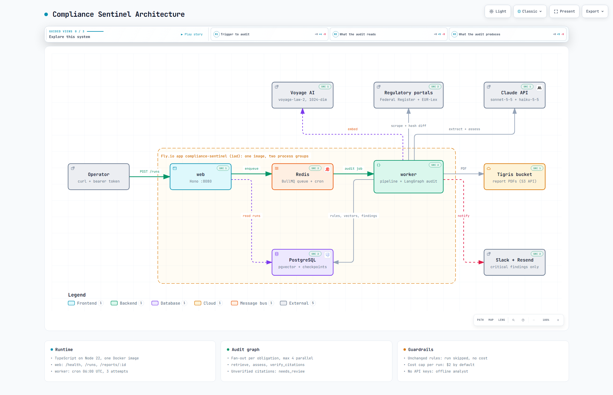
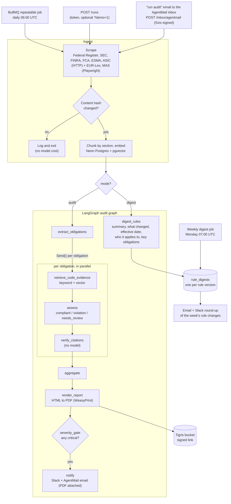

# Compliance Sentinel

When a regulation with a deadline applies to you, an auditor or regulator wants proof of where your code meets each requirement. Today an engineer and a compliance person build that mapping by hand, one requirement at a time, in a spreadsheet. Compliance Sentinel builds it from the rule text and the repository: every obligation tied to a `file:line`, with the regulation section cited, in an audit-ready report.

Give it a rule (or let it pick up new and amended rules from eight regulatory sources each day). It embeds the rule text, extracts the obligations a software team would have to implement, searches the target repository for evidence, and judges each obligation as compliant, a violation, or needing human review. Citations are checked mechanically: a cited chunk must belong to the rule and a cited `file:line` must exist, or the verdict is downgraded. Critical violations go to Slack and email, and the email inbox is two-way: reply "run audit" and a run is queued.

> This is decision support, not legal advice. It does not guarantee compliance or complete coverage of any regulation.

## Status

| Part | State |
|---|---|
| Scrape, change detection, embedding, LangGraph audit, report, alerts | Built and tested (112 tests) |
| Dashboard (Next.js 16, Clerk) in [web/](web) | Built; 7 Playwright e2e tests against a mock API; verified locally against Neon. Deployed to Vercel at <https://compliance-sentinel-web.vercel.app> with Clerk keys set; signed-in pages not yet checked in production |
| Federal Register API source | Verified against the live API |
| EUR-Lex Playwright source | Verified against the live site (GDPR: 99 articles, plus its corrigendum) |
| SEC source (Federal Register API filtered to the SEC) | Verified against the live API (fetches SEC final rules with full regulatory text) |
| FCA publications RSS source | Verified against the live feed (publication pages fetched and reduced to body text) |
| MAS circulars source (Playwright + pdftotext) | Verified locally against the live site (2 circulars, page text plus PDF text); **not yet run inside the Docker image**. Off by default (`SCRAPE_MAS=true`) |
| ESMA news, FINRA notices, ASIC regulatory tracker sources | Verified against the live sites (ESMA and FINRA items with page text; ASIC regulatory guides with page and PDF text, capped at `ASIC_MAX_CHARS`) |
| AgentMail email: alerts and digests sent from the app's inbox, "run audit" emails accepted through a signed webhook | Outbound verified (weekly digest delivered from `alerts@intelliforge.tech`); inbound route unit-tested, **webhook not yet registered** on the deployed app |
| Regulatory change digest (graph node) and weekly digest delivery | Verified against Neon: `pnpm digest:run --demo` digested the 5 demo rules (run 14) and the weekly digest covered 17 rule changes, reusing stored digests, and was delivered by email from the AgentMail inbox. Digests stored before the API key was set are the offline baseline; new rule versions are digested by Claude |
| Full run on live sources, then a second run that correctly skips | Verified locally |
| Neon Postgres with pgvector, including the Postgres checkpointer | Verified: migrations and a demo audit ran against Neon |
| Audit with Claude (`claude-sonnet-5-5`, `claude-haiku-5-5`) | Verified: golden eval run three times on each planted set, 28 of 30 found on the ten-violation set, about $0.50 per run (see [Evaluation](#evaluation)) |
| Voyage `voyage-law-2` embeddings | Implemented, **not yet run**: needs `VOYAGE_API_KEY`. The eval above used the local hash embedder |
| Audits of real open-source repositories (`pnpm audit:real`) | Run with Claude on three pinned repos for $3.82. Precision is 42% (10 of 24 violations true) on a first-pass label by Claude Code, **not yet confirmed by a person** (see [samples/real](samples/real)) |
| GitHub Action ([action.yml](action.yml), [docs/github-action.md](docs/github-action.md)) | Audit step, Markdown summary and `--fail-on` exit codes verified locally; **not yet run on GitHub** |
| PCI DSS v4.0.1 rules (paraphrased) and five planted PCI violations in the demo app | Offline golden test passes on all ten planted violations |
| Docker image and PDF rendering with WeasyPrint | Verified in CI on every push (image builds, demo report renders to a 17-page PDF) |
| BullMQ worker and cron | Implemented and typechecked; **not yet run against Redis** |
| Fly.io deployment | Deployed at <https://compliance-sentinel-gengirish.fly.dev> (`/health` returns 200; other routes need the token) |
| Loom demo | Not recorded yet |

Without API keys the pipeline still runs end to end using two labelled stand-ins: a keyword-based offline analyst instead of Claude, and a local hash embedder instead of Voyage. That is what the tests and the sample report use.

## Sample report

[samples/report-example.pdf](samples/report-example.pdf) is the report for the demo rules audited against [demo-target-app](demo-target-app), produced by the offline analyst and rendered by WeasyPrint inside the production image. The `image` job in CI rebuilds it on every push and attaches it to the run as the `demo-report` artifact. [samples/report-example.html](samples/report-example.html) is the HTML it is rendered from.

## Architecture



[docs/architecture.html](docs/architecture.html) is the interactive version (open it locally): each component links to its source file, and three guided views walk through the trigger path, the audit's inputs and its outputs. It is generated from [docs/architecture.json](docs/architecture.json) with Archify.

The pipeline, step by step:



One Fly app runs two process groups from the same image:

- `web`: a small Hono server. `GET /health`, `POST /runs` (manual trigger), `GET /runs` (`?counts=1` adds finding counts), `GET /runs/:id`, `GET /runs/:id/findings` (`?status=` and `?severity=` take comma lists), `GET /rules`, `GET /stats`, and `GET /reports/:id` (redirects to a freshly signed link). Everything except `/health` needs `RUN_TRIGGER_TOKEN`. Path params and query strings are validated with zod ([src/web/schemas.ts](src/web/schemas.ts)): a bad run id, flag or filter value gets a 400 that names the field, rather than being silently ignored. It can scale to zero.
- `worker`: the BullMQ worker, which also registers the daily schedule. One machine, always on.

The dashboard in [web/](web) is a separate Next.js app, deployed to Vercel. Its server components call the API with the token; the browser only talks to the dashboard, which signs users in with Clerk.

## Dashboard

[web/](web) is built on the IntelliForge stack: Next.js 16 App Router, React 19, Tailwind 4, Clerk, zod and lucide-react. It has its own `package.json` and lockfile, so the API's image and CI are unaffected.

| Page | Shows |
|---|---|
| `/` | Public landing page: what the agent does, a sample finding, and the demo evaluation |
| `/overview` | Finding counts from the latest completed audit, its critical violations, and a **Run audit** button |
| `/runs` | The 20 most recent runs with status, duration, violations and cost |
| `/runs/[id]` | Every finding in a run, filterable by verdict and severity, each with its regulation citation and `file:line` evidence |
| `/rules` | Tracked regulations, their source, last change and last audit |
| `POST /inbox/agentmail` | AgentMail webhook for mail sent to the app's inbox (signature-authenticated, no token) |

Run it locally next to the API:

```bash
pnpm dev:web                         # API on :8080 (repo root)
cd web && pnpm install
cp .env.example .env.local           # SENTINEL_API_TOKEN = the root RUN_TRIGGER_TOKEN, plus Clerk keys
pnpm dev                             # dashboard on :3000
pnpm test:e2e                        # builds the app and runs Playwright against tests/e2e/mock-api.mjs
```

**Run audit** only queues a job. It needs Redis and the worker (`docker compose up -d`, `pnpm dev:worker`); without them the button reports that the queue is unreachable.

To deploy, import the repo into Vercel with **Root Directory** set to `web` ([web/vercel.json](web/vercel.json) pins the framework to Next.js), and set `SENTINEL_API_URL` (the Fly app's URL), `SENTINEL_API_TOKEN`, `NEXT_PUBLIC_CLERK_PUBLISHABLE_KEY` and `CLERK_SECRET_KEY`.

## How it works

1. **Scrape.** The Federal Register's JSON API returns recent final rules; the binding regulatory text is separated from the preamble commentary. EUR-Lex is scraped with Playwright because it renders through JavaScript; the base act and the acts that amend or correct it are collected. SEC final rules come from the same Federal Register API filtered to the SEC (EDGAR holds company filings, not rulemaking). FCA policy statements, consultation papers and guidance come from the FCA publications RSS feed, with the text of each publication page. MAS circulars are listed by a JavaScript search page behind a WAF, so Playwright opens the listing and each circular, and the circular's PDF is converted with pdftotext; this source is off by default (`SCRAPE_MAS=true`) because it needs Chromium and poppler-utils, both of which the Docker image has. ESMA news comes from the site-wide RSS feed (the news-page feed URL answers with HTML), FINRA notices from the notices RSS feed with the full notice text from each page, and ASIC documents from the regulatory tracker, a server-rendered table per year of new and reissued regulatory guides, information sheets and reports, with each guide's PDF converted by pdftotext.
2. **Diff.** Rule text is normalised and hashed. Only rules that are new or whose hash changed go further, so a quiet day costs nothing.
3. **Embed.** Rules are split on article and section headings so each chunk maps to a citable unit, then embedded into pgvector. The target repository is indexed in line windows at a recorded snapshot.
4. **Extract obligations.** For each rule the model lists the duties software must implement, with the chunk ids that state each one and search keywords for the codebase. Chunk ids the model was not shown are discarded.
5. **Retrieve evidence.** Per obligation, keyword search over the indexed files is combined with vector similarity.
6. **Assess.** The model judges the obligation against the evidence. A verdict needs at least one regulation chunk and one code location, otherwise it must answer `needs_review`.
7. **Verify citations.** With no model involved, every cited chunk must exist and belong to the rule, and every `file:line` range must exist in the indexed snapshot. Failures are dropped; a verdict left without both kinds of support is downgraded to `needs_review`.
8. **Report and alert.** Findings are deduplicated, rendered to PDF, stored, and a critical violation triggers Slack and email. Email goes out from the app's own [AgentMail](https://agentmail.to) inbox with the PDF attached. Mail sent to that inbox is delivered to `POST /inbox/agentmail` (Svix-signed); when an alert recipient asks to "run audit" (or "run the demo audit"), a run is queued and the inbox replies in the thread. Anything else is logged and ignored.

**Digest mode.** The graph has a second output mode. With `mode: "digest"` the run goes from `START` to `digest_rules` instead of `extract_obligations`: each rule in scope gets a plain-language digest (summary, what changed versus the previous text, effective date, who it applies to, key obligations) stored once per rule version in `rule_digests`, and no code is audited. `pnpm digest:run --demo` shows it on the bundled rules. The **weekly digest** (`DIGEST_CRON`, Monday 07:00 UTC) takes every rule whose text changed in the last `DIGEST_DAYS` days, whether or not the daily audit judged it relevant, reuses stored digests, and sends one round-up by email and Slack. It costs no retrieval and no code audit, only a short Haiku call per new rule version; `pnpm digest:run [--days 7] [--send]` runs it by hand.

Guardrails: a per-run cost cap (`MAX_RUN_COST_USD`), retries with backoff on every node, and graph state checkpointed to Postgres after each step. A run that fails marks its rules as unaudited so the job retry, or the next day's run, picks them up again. Resuming a crashed run from its checkpoint is not wired up yet: a retry starts a fresh run.

## Setup

Requires Node 22 and pnpm. Nothing else is needed for a dry run.

```bash
git clone https://github.com/gengirish/compliance-sentinel.git && cd compliance-sentinel
pnpm install
cp .env.example .env          # optional: add keys to use Claude, Voyage, Slack
pnpm audit:run --demo         # audit the demo app against the bundled demo rules
pnpm test
```

`pnpm audit:run` (no flag) scrapes the live sources instead; it needs `npx playwright install chromium` once, or `SCRAPE_EURLEX=false`. `SCRAPE_SEC` and `SCRAPE_FCA` default to on and need no browser; `SCRAPE_MAS` defaults to off and needs the browser plus `pdftotext`.

Those flags are only defaults. The dashboard's **Settings** page has a switch per source, saved in the `source_settings` table and read at the start of every run, so a change needs no restart; **Reset** hands a source back to its flag. A switched-off source is not fetched, so its rules stop changing and never enter an audit. Demo runs use the bundled rules and ignore the switches. Only the operator (requests without a tenant header) can see or change them: `GET /settings/sources`, `PUT /settings/sources/:name` with `{"enabled": true | false | null}`.

Other commands:

| Command | What it does |
|---|---|
| `pnpm audit:run --rules 1,2` | Audit rules already in the store, without scraping |
| `pnpm digest:run [--days 7] [--send]` | Build (and optionally send) the digest of rule changes in the window |
| `pnpm digest:run --demo` | Run the graph in digest mode on the bundled demo rules |
| `pnpm eval:golden` | Score a demo audit against the planted violations |
| `pnpm eval:retrieval` | Print top-k rule and code chunks for ten hand-written queries |
| `pnpm db:migrate` | Apply migrations |
| `pnpm dev:web` / `pnpm dev:worker` | Run the HTTP server or the queue worker (worker needs Redis) |
| `pnpm dev:dashboard` | Run the Next.js dashboard on :3000 (see [Dashboard](#dashboard)) |
| `docker compose up -d` | Local Redis for the queue |

Set `DATABASE_URL` to a Neon connection string to use Neon locally too. With it unset the app uses an embedded PGlite database under `.data/`, so a dry run needs neither Neon nor Docker.

## Deploy to Fly.io

```bash
fly launch --no-deploy --copy-config        # keep the provided fly.toml
neonctl projects create --name compliance-sentinel-db --region-id aws-us-east-1   # prints the connection string
fly redis create                            # Upstash; set eviction to "noeviction"
fly storage create                          # Tigris bucket; prints the bucket name and keys

fly secrets set \
  DATABASE_URL='postgresql://...neon.tech/neondb?sslmode=verify-full' \
  REDIS_URL=... ANTHROPIC_API_KEY=... VOYAGE_API_KEY=... \
  SLACK_WEBHOOK_URL=... AGENTMAIL_API_KEY=... AGENTMAIL_INBOX_ID=... ALERT_EMAIL_TO=... \
  TIGRIS_BUCKET=... TIGRIS_ACCESS_KEY_ID=... TIGRIS_SECRET_ACCESS_KEY=... \
  RUN_TRIGGER_TOKEN=$(openssl rand -hex 24)

fly deploy                                  # if the Depot builder fails with an x509 error, add --depot=false
fly scale count web=1 worker=1
```

The database is [Neon](https://neon.tech) Postgres. Use the direct connection string rather than the `-pooler` one, because migrations and the LangGraph checkpointer hold session state. The first migration enables the `vector` extension. Then trigger a demo run and watch it:

```bash
curl -X POST "https://<app>.fly.dev/runs?demo=1" -H "Authorization: Bearer $RUN_TRIGGER_TOKEN"
fly logs --process-group worker
```

`fly storage create` names its secrets `BUCKET_NAME`, `AWS_ACCESS_KEY_ID` and `AWS_SECRET_ACCESS_KEY`; copy their values into the `TIGRIS_*` names above.

## Evaluation

[demo-target-app](demo-target-app) is a small Express API with ten planted violations and two areas that are implemented correctly:

| Planted violation | Where |
|---|---|
| Personal data in logs | `src/routes/signup.js`, `src/routes/patients.js` |
| No data-retention job | `src/jobs/index.js` |
| Plaintext secrets | `src/config.js` |
| Marketing opt-in assumed, no consent capture | `src/routes/signup.js`, `schema.sql` |
| No breach-notification step | `src/routes/incidents.js` |
| PCI DSS 3.4.1: full card number written to the log | `src/routes/payments.js` |
| PCI DSS 3.3.1: card verification code stored after authorisation | `src/routes/payments.js`, `schema.sql` |
| PCI DSS 3.5.1: card numbers stored in plaintext | `schema.sql` |
| PCI DSS 4.2.1: card data sent to the processor over plain HTTP | `src/routes/payments.js` |
| PCI DSS 8.2.2: one shared login for the admin console | `src/config.js` |

The five PCI DSS violations were added on 2026-10-27, together with a paraphrased PCI DSS v4.0.1 rule file. The first five rows are the original set.

Compliant areas that must not be flagged: TLS enforcement (`src/middleware/https.js`) and access control (`src/middleware/auth.js`).

Claude also reported gaps the demo app really has but that were never planted: no multi-factor authentication, no way to withdraw marketing consent, and no audit trail of user activity. Each was confirmed by reading the code and is listed in `CONFIRMED_GAPS` in [src/eval/golden.ts](src/eval/golden.ts). Precision is reported two ways: strictly against the planted list, and counting those confirmed gaps as correct.

| Analyst | Planted set | Runs | Recall | Precision, planted only | Precision, incl. confirmed gaps | False positives per run | Compliant areas flagged | Cost per run |
|---|---|---|---|---|---|---|---|---|
| Offline keyword baseline | 10 (with PCI DSS) | 1 | 10/10 | 100% | 100% | 0 | 0 | $0 |
| Claude (`claude-sonnet-5-5` assess, `claude-haiku-5-5` relevance) | 5 (original) | 3 | 5/5, 5/5, 5/5 | 78%, 76%, 82% | 94%, 88%, 100% | 1, 2, 0 | 0 | $0.45, $0.45, $0.44 |
| Claude (same models) | 10 (with PCI DSS) | 3 | 8/10, 10/10, 10/10 | 83%, 89%, 80% | 94%, 100%, 93% | 1, 0, 2 | 0 | $0.47, $0.56, $0.56 |

Measured 2026-10-27 with the local hash embedder, because `VOYAGE_API_KEY` was not set; about 90 seconds per run. The raw results are in [samples/eval/](samples/eval). One run missed the card number in the logs and the plain-HTTP call to the processor. Every false positive across the six runs was a governance duty that does not live in code, such as a patching timeframe, a register of important business services, or incident containment. Those should be `needs_review`; that is the next prompt fix.

The offline row shows that the pipeline, retrieval and citation checks work. It says little about reasoning quality, because the baseline's patterns were written with this demo app in view.

Before these runs, Claude found the planted violations 4, 4 and 3 times out of 5. It always missed the retention job: it saw no deletion code but would not call it absent from a repository it had seen only in excerpts. The judge now also gets a repository-wide keyword count per search term and the list of indexed files, so "absent" is a measured fact rather than a guess.

The test suite additionally checks that a model returning invented citations ends with every finding downgraded to `needs_review` and no alert sent.

## Environment variables

See [.env.example](.env.example) for the full list with defaults. The main ones: `DATABASE_URL`, `REDIS_URL`, `ANTHROPIC_API_KEY`, `VOYAGE_API_KEY`, `SLACK_WEBHOOK_URL`, `AGENTMAIL_API_KEY`, `AGENTMAIL_INBOX_ID`, `AGENTMAIL_WEBHOOK_SECRET`, `ALERT_EMAIL_TO`, `TIGRIS_*`, `TARGET_REPO_PATH` or `TARGET_REPO_URL`, `RUN_TRIGGER_TOKEN`, `AUDIT_CRON`, `DIGEST_CRON`, `MAX_RUN_COST_USD`, and the per-source `SCRAPE_*` switches.

## Limitations

- **Not legal advice.** A "compliant" result means supporting code was found, not that the obligation is fully met.
- **Code only.** Controls that live in infrastructure, vendor systems or policy documents are invisible to the audit.
- **Eight sources, narrow queries.** Coverage is whatever the Federal Register and SEC search terms, the configured FCA publication types and FINRA notice kinds, the latest ESMA news, MAS circulars and ASIC tracker entries, and one EUR-Lex act return. ESMA and FINRA items are news and notices, not consolidated rulebooks.
- **Reports only.** It does not fix code or open pull requests.
- **Single tenant.** One target repository. Every signed-in dashboard user sees every run; there are no roles.
- **Citations can go stale.** Findings store rule chunk ids without a foreign key, and re-embedding a rule replaces its chunks, so an older run's citations stop resolving. The dashboard says so; the PDF report keeps the text it was rendered with.
- **Long rules are capped.** Text beyond each source's `*_MAX_CHARS` is cut, with a warning in the logs.
- **Digests are summaries.** A digest is the model's reading of the rule text (or, without an API key, a keyword baseline), not a legal analysis.
- **Scrapers break.** A source that fails or returns nothing is logged and skipped; the other sources still run.

## Where the build differs from the plan

- **Structured output, not forced tool use.** `claude-sonnet-5-5` rejects forced `tool_choice`, so the analyst uses the SDK's structured outputs (`messages.parse` with Zod schemas).
- **Keyword search is in-process**, not a `ripgrep` subprocess. It searches the indexed snapshot in the database, so evidence always matches the lines that citations are verified against.
- **Chunks follow sections** rather than a fixed 800 to 1,200 tokens: a section stays one chunk up to 1,200 tokens so a citation points at one article.
- **Deduplication is by rule and code location**, not rule and file, so two different duties broken in one file stay separate findings.
- **Neon instead of Fly Postgres** for the database (the plan allowed either).
- **Embedded database for tests and dry runs** (PGlite with pgvector), so they need no network or Docker. The checkpointer is in-memory in that mode and Postgres-backed on Neon.
- **Migrations are plain SQL files** applied by a small runner; the Drizzle schema is used for queries.

## Repository layout

```
src/
  scrape/     federalRegister.ts, secRules.ts, finraNotices.ts, fcaPublications.ts, esmaNews.ts,
              asicTracker.ts, eurLex.playwright.ts, masCirculars.playwright.ts, rss.ts, html.ts, pdf.ts, http.ts, diff.ts
  digest/     digestRule.ts, weekly.ts, deliver.ts, textDiff.ts   the digest output mode and the weekly round-up
  rag/        chunker.ts, embed.ts, retrieve.ts, indexRepo.ts
  graph/      state.ts, graph.ts, nodes/ (incl. digest.ts), controls.ts, evidence.ts
  llm/        claudeAnalyst.ts, offlineAnalyst.ts
  report/     template.html, render.ts, upload.ts
  notify/     slack.ts, email.ts, agentmail.ts
  queue/      queue.ts, worker.ts, schedule.ts
  web/        server.ts         the API the dashboard reads
  pipeline/   run.ts            scrape -> diff -> embed -> graph, one function
  db/         schema.ts, client.ts, migrations/
  cli/        auditRun, digestRun, evalGolden, evalRetrieval, failStaleRuns, indexRepo, migrate
demo-target-app/   seeded Express app with planted violations
fixtures/rules/    abridged GDPR and FTC Safeguards Rule excerpts for demo runs
tests/             diff, chunker, citation checks, golden audit, scrapers, outputs
samples/           report-example.pdf, report-example.html
```
